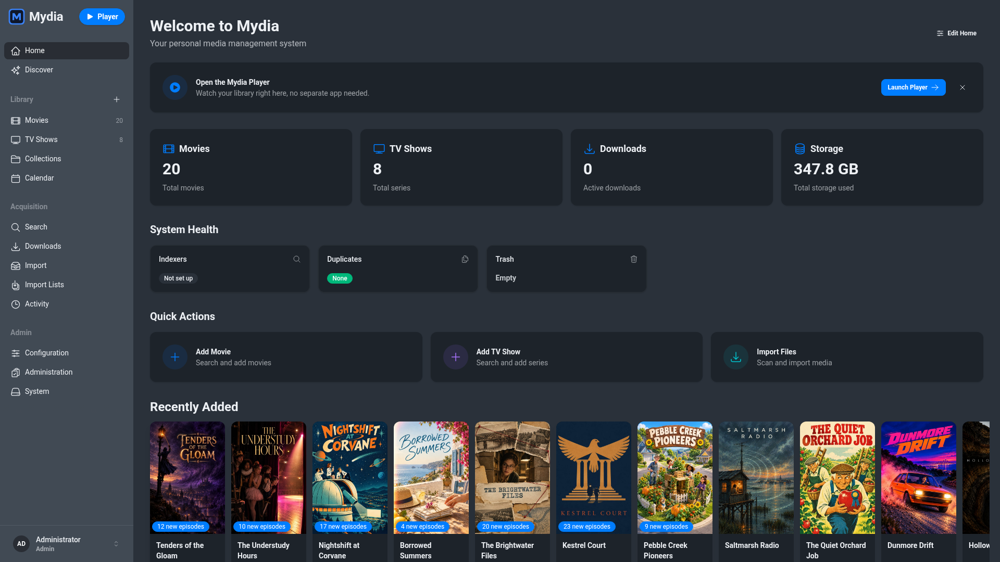
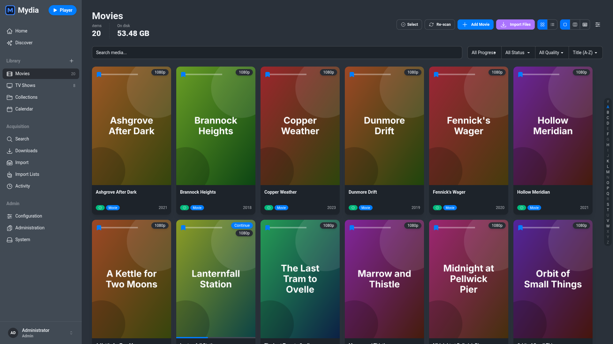
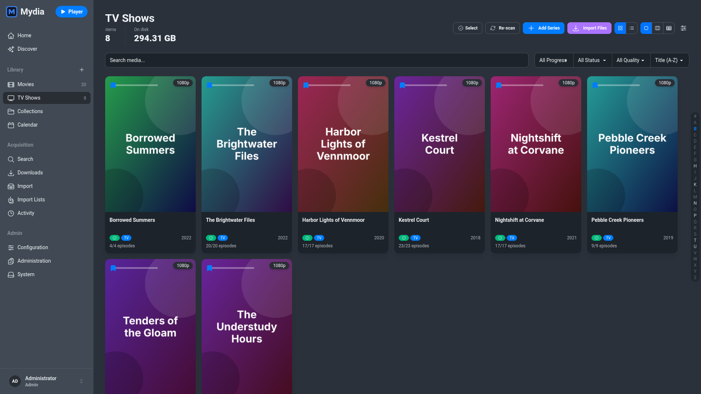
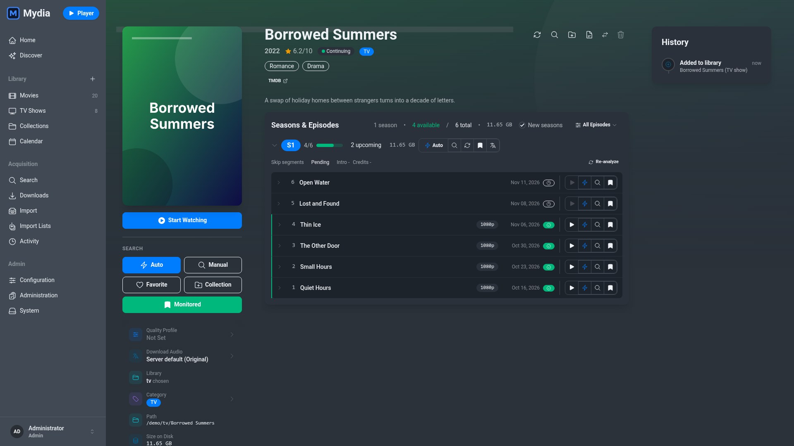
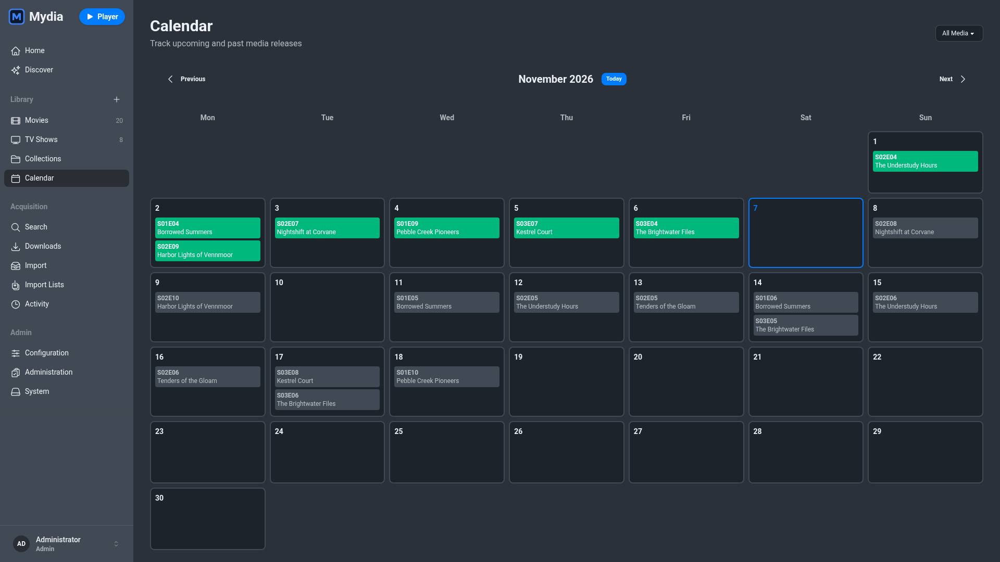
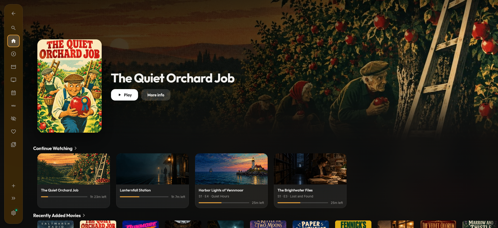
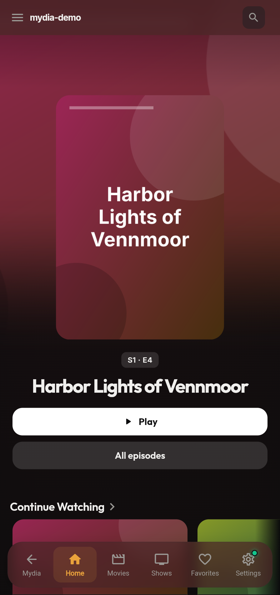
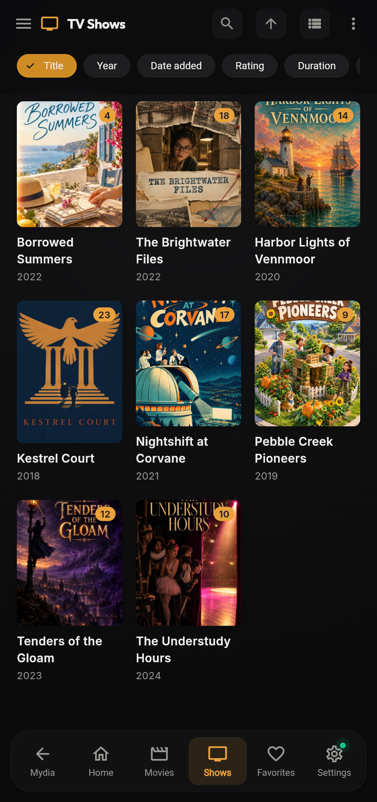

# Mydia

[](https://github.com/getmydia/mydia/actions/workflows/ci.yml)
[](https://docs.mydia.dev)
[](https://repowise.dev/repo/getmydia/mydia)
[](https://testflight.apple.com/join/KFSYxaQP)
[](https://hosted.weblate.org/engage/mydia/)

Mydia is two open source apps for your movies and TV.

- **[Mydia Server](#mydia-server)** runs your library. It organizes what you
  have, finds what is missing and downloads it. One self-hosted app where the
  usual setup needs Sonarr, Radarr, Prowlarr and Overseerr.
- **[Mydia Player](#mydia-player)** plays your media on every screen you own.
  Think Infuse, but open source, free, and not limited to Apple devices.

Each one stands on its own. The player is happy with Plex or Jellyfin and no
Mydia Server at all, and the server works fine with whatever player you already
use. Run them together and you get [a few things neither does
alone](#better-together).

> [!TIP]
> **Speak another language? Help translate Mydia.** Translations happen on
> [Weblate](https://hosted.weblate.org/engage/mydia/) with a free account, no
> git or code needed.
>
> <a href="https://hosted.weblate.org/engage/mydia/">
>   <picture>
>     <source media="(prefers-color-scheme: dark)" srcset="https://hosted.weblate.org/widget/mydia/287x66-black.png" />
>     
>   </picture>
> </a>

## Mydia Server

<p align="center">
  <picture>
    <source media="(prefers-color-scheme: light)" srcset="screenshots/homepage-light.png" />
    
  </picture>
</p>

### Why not Sonarr and Radarr?

A typical *arr install is four or five services that each keep their own copy of your
settings, and most households only wanted one app.

| | Mydia Server | The *arr stack |
|---|---|---|
| Movies and TV | One app, one library, one set of quality profiles | Radarr for movies, Sonarr for TV, configured twice |
| Indexers | Prowlarr or Jackett, or built-in Cardigann definitions (experimental) | Prowlarr or Jackett |
| Family and friends | Accounts, guest roles and requests built in | Add Overseerr or Ombi |
| Single sign-on | OIDC built in | Local login, or forward auth at your reverse proxy |
| Configuration | Web UI, YAML file or environment variables, and the UI shows where each value came from | Web UI only |
| Debrid | Built-in providers next to your torrent and Usenet clients | Through third-party tools |
| Watching remotely | Mydia Player connects peer-to-peer, no port forwarding or VPN | Not their job; run a media server |

Configuration deserves a sentence of its own. You can declare download clients,
indexers and libraries in a Compose file so they exist on first boot, and still
change them later in the browser. The *arr apps keep everything in their own
database, so a fresh instance always starts with clicking.

### What it does

- **Library and metadata.** Scans your folders (or an S3 bucket) and fills in
  posters, descriptions and episode details from TMDB and TVDB.
- **Automated downloads.** Monitors what you want, picks a release that matches
  your languages, quality profile and custom formats, and upgrades it later when
  something better shows up. [How it picks a release](docs/using/explanation/quality-decisions.md).
- **Download clients.** qBittorrent, Transmission, rqbit, SABnzbd, NZBGet and
  debrid providers.
- **Requests.** Guests ask, admins approve, the download starts.
- **Import lists.** Follow TMDB watchlists, popular and trending (experimental).
- **Plugins.** Sandboxed add-ons that can only do what you approve.
- **Your database.** SQLite by default, PostgreSQL if you prefer.
- **Themes and languages.** Light, dark and several community themes, with the
  interface translated by contributors.

| Movies | TV Shows | Series | Calendar |
|:------:|:--------:|:------:|:--------:|
|  |  |  |  |

### Quick start

Generate two secrets:

```bash
openssl rand -base64 48  # SECRET_KEY_BASE
openssl rand -base64 48  # GUARDIAN_SECRET_KEY
```

Create `docker-compose.yml`:

```yaml
services:
  mydia:
    image: ghcr.io/getmydia/mydia:latest
    container_name: mydia
    environment:
      - PUID=1000
      - PGID=1000
      - TZ=America/New_York
      - SECRET_KEY_BASE=your-secret-key-base-here
      - GUARDIAN_SECRET_KEY=your-guardian-secret-key-here
      - PHX_HOST=localhost
      - MOVIES_PATH=/media/library/movies
      - TV_PATH=/media/library/tv
    volumes:
      - ./config:/config
      - /path/to/media:/media
    ports:
      - 4000:4000
    restart: unless-stopped
```

Start it with `docker compose up -d`, open http://localhost:4000 and create your
admin account. NixOS, PostgreSQL, reverse proxies and SSO are covered in the
[how-to guides](https://docs.mydia.dev/latest/using/how-to/).

## Mydia Player

<p align="center">
  
</p>

Infuse set the bar for a good-looking player that sits on top of the servers
and shares you already have. Mydia Player aims at the same job. The differences
are that it is AGPL-licensed, costs nothing, and runs on Android, Android TV,
Windows and Linux as well as iPhone, iPad and Mac.

| | Mydia Player | Infuse |
|---|---|---|
| License | Open source (AGPL-3.0) | Closed source |
| Price | Free, every feature | Free tier, with Pro by subscription or lifetime purchase |
| Platforms | Android, Android TV, iOS, iPadOS, macOS, Windows, Linux, web | iOS, iPadOS, tvOS, macOS, visionOS |
| Servers | Plex (with Home profiles), Jellyfin, Stash, Mydia Server | Plex, Jellyfin, Emby |
| Files | Local folders, SMB and WebDAV, with metadata matching (beta) | SMB, NFS, WebDAV, FTP and cloud drives |
| Casting | Chromecast, DLNA and AirPlay | AirPlay |
| Offline downloads | Yes, from every server; transcoded sizes from Mydia Server | Yes |
| Continue watching | One row across all your servers | Per library, plus Trakt sync |
| Away from home | Peer-to-peer to Mydia Server, no port forwarding or VPN | Whatever your server or share exposes |

| Home | Shows |
|:----:|:-----:|
|  |  |

### Install

| Platform | Get it | Notes |
|---|---|---|
| Android and Android TV | [Download APK](https://mydia.dev/download/android) | Allow installs from unknown sources; updates itself afterward, track chosen in Settings |
| iOS | [Install via TestFlight](https://testflight.apple.com/join/KFSYxaQP) | Needs the TestFlight app |
| macOS | [Download .dmg](https://mydia.dev/download/macos) | Notarized, updates itself |
| Windows | `irm https://mydia.dev/install.ps1 \| iex` in PowerShell, or [download installer](https://mydia.dev/download/windows) | Per-user install. The command avoids the SmartScreen prompt the unsigned installer gets |
| Linux | [Flatpak](https://mydia.dev/download/flatpak) or [.tar.gz](https://mydia.dev/download/linux) | Flatpak recommended |
| Web | Served by your own Mydia Server at `/player` | Nothing to install |

[All platforms and install instructions](https://mydia.dev/download).
To use it with Plex, Jellyfin or Stash, see
[Connect Plex, Jellyfin or Stash](https://docs.mydia.dev/latest/using/how-to/connect-other-servers/).

## Better together

Neither app needs the other. Pair them and:

- The player reaches your server from anywhere over an encrypted peer-to-peer
  connection. No port forwarding, VPN or dynamic DNS; when a direct path is
  blocked, a relay carries the traffic. [How remote access works](docs/using/explanation/remote-access.md).
- Offline downloads can be transcoded to a smaller size on the server before
  they reach your phone.
- Everyone signs in to the player with the account you gave them on the
  server, and keeps their own watch progress.
- Your server serves a web build of the player at `/player`, so a browser is
  enough.

## Documentation

Everything is at **[docs.mydia.dev](https://docs.mydia.dev)**:

- [Tutorials](https://docs.mydia.dev/latest/using/tutorials/) to get Mydia running from scratch
- [How-to guides](https://docs.mydia.dev/latest/using/how-to/) for installing, connecting clients and indexers, and deploying
- [Reference](https://docs.mydia.dev/latest/using/reference/) for environment variables, configuration, database and API
- [Explanation](https://docs.mydia.dev/latest/using/explanation/) for how Mydia works and why

## Contributing

```bash
./dev up -d              # Start development environment
./dev mix ecto.migrate   # Run migrations
./dev mix test           # Run tests
./dev mix precommit      # Run all checks
```

See the [Development Guide](https://docs.mydia.dev/latest/contributing/setup/)
for the server and `player/docs/` for the player.

### Translations

Mydia Server and Mydia Player are translated on
[Weblate](https://hosted.weblate.org/projects/mydia/). You need a free Weblate
account, no git and no code. See [TRANSLATING.md](TRANSLATING.md) for the conventions and glossary.

[](https://hosted.weblate.org/engage/mydia/)

### Documentation site

The docs site is built with [MkDocs](https://www.mkdocs.org/) and
[Material for MkDocs](https://squidfunk.github.io/mkdocs-material/), and needs
[uv](https://docs.astral.sh/uv/):

```bash
uv sync --project docs               # Install dependencies
uv run --project docs mkdocs serve   # Serve at http://localhost:8000
uv run --project docs mkdocs build   # Build static site to /site
```

## License

[AGPL-3.0](LICENSE).
