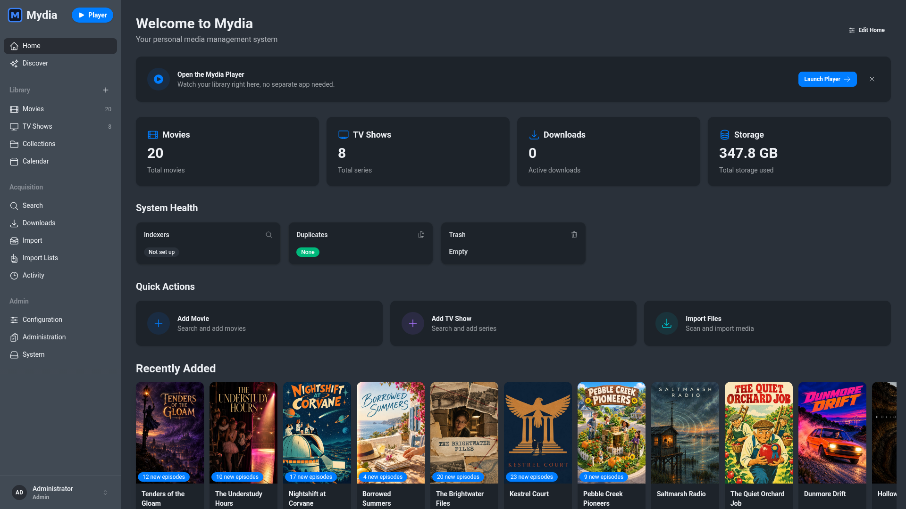
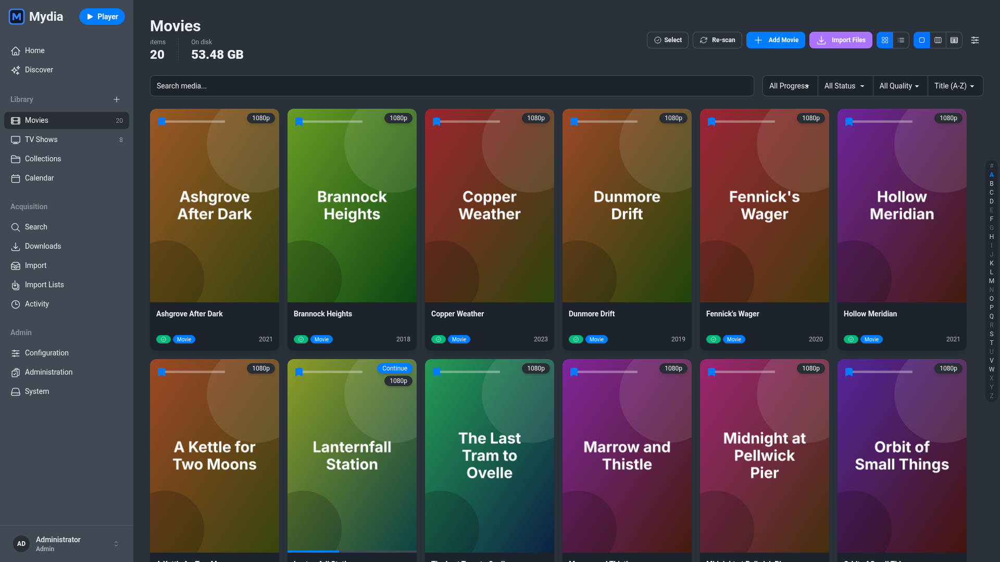
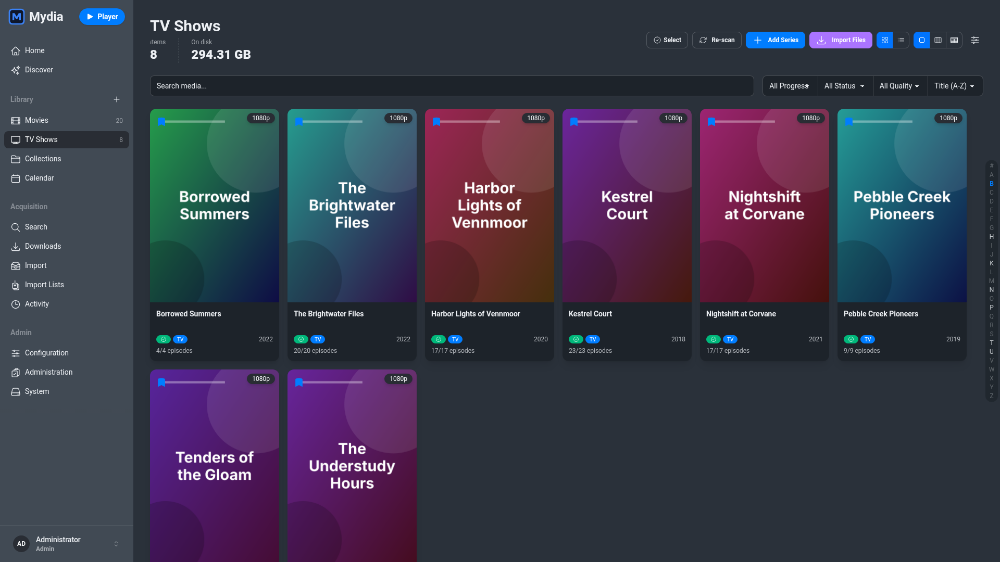
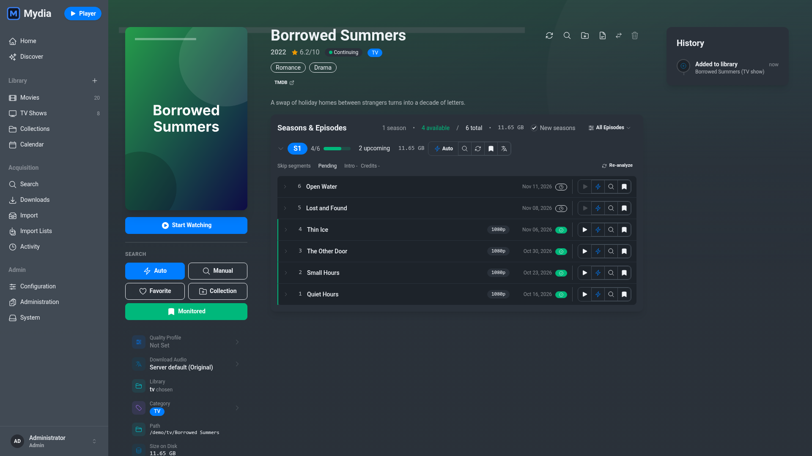
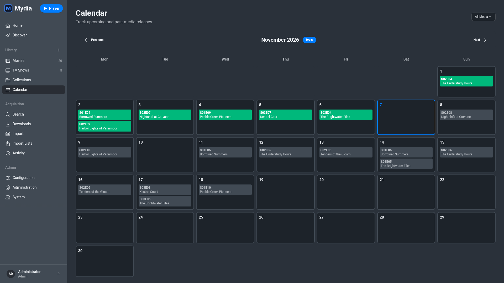
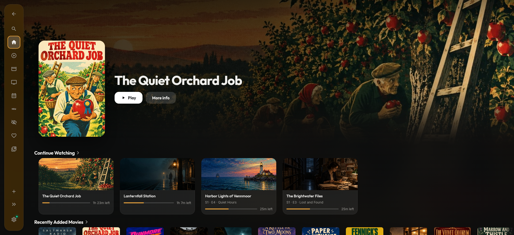
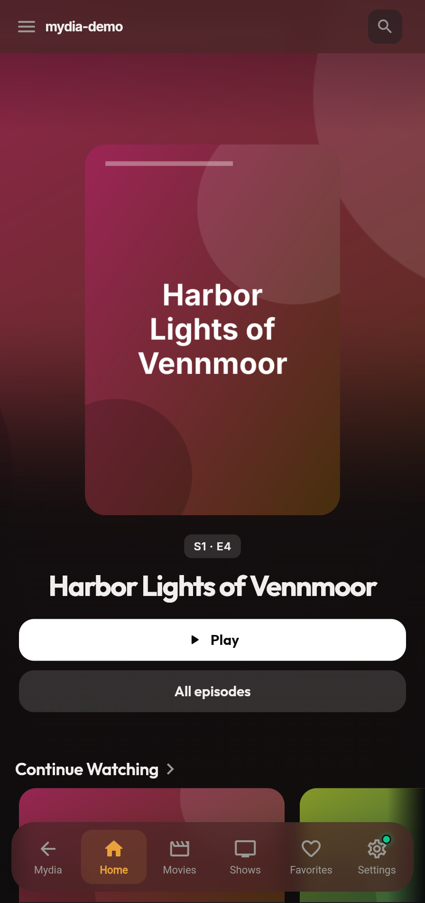
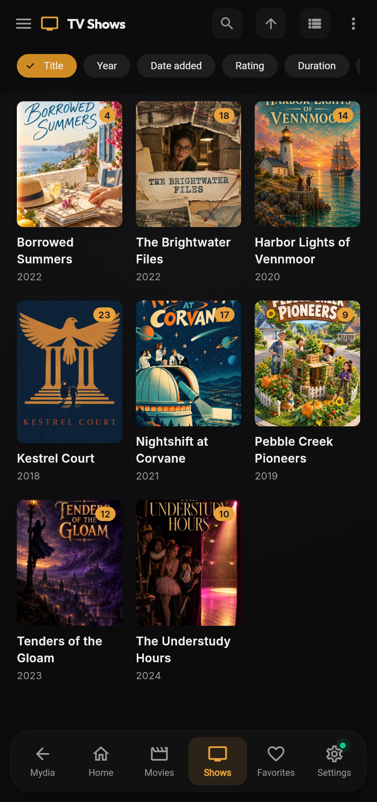

# Mydia

[](https://github.com/getmydia/mydia/actions/workflows/ci.yml)
[](https://docs.mydia.dev)
[](https://repowise.dev/repo/getmydia/mydia)
[](https://testflight.apple.com/join/KFSYxaQP)
[](https://hosted.weblate.org/engage/mydia/)

Mydia is two open-source apps for movies and TV shows:

- **[Mydia Server](#mydia-server)** is a self-hosted library manager and
  automated downloader. It replaces a separate Sonarr, Radarr, Prowlarr and
  Overseerr setup with a single application.
- **[Mydia Player](#mydia-player)** is a media player for Android, Android TV,
  iOS, iPadOS, macOS, Windows, Linux and the web. It plays from Plex, Jellyfin,
  Stash, Mydia Server, local folders and network shares.

Either app can be used on its own. Mydia Player works with existing Plex or
Jellyfin servers without Mydia Server installed, and Mydia Server can manage a
library on disk for any other media player. [Running both together](#better-together)
adds peer-to-peer remote streaming, shared user accounts and server-side
transcoding for offline downloads.

> [!TIP]
> **Help translate Mydia.** Translations are managed on
> [Weblate](https://hosted.weblate.org/engage/mydia/) in the browser with a free
> account.
>
> <a href="https://hosted.weblate.org/engage/mydia/">
>   <picture>
>     <source media="(prefers-color-scheme: dark)" srcset="https://hosted.weblate.org/widget/mydia/287x66-black.png" />
>     
>   </picture>
> </a>

## Mydia Server

<p align="center">
  <picture>
    <source media="(prefers-color-scheme: light)" srcset="screenshots/homepage-light.png" />
    
  </picture>
</p>

### Comparison with the *arr stack

Running a full *arr setup typically means deploying four or five separate
services and keeping their settings in sync across each one.

| | Mydia Server | The *arr stack |
|---|---|---|
| Movies and TV | Single app, library and set of quality profiles | Radarr for movies and Sonarr for TV, configured separately |
| Indexers | Prowlarr, Jackett, or built-in Cardigann definitions (experimental) | Prowlarr or Jackett |
| User accounts and requests | Built-in accounts, guest roles and approval workflow | Requires Overseerr or Ombi |
| Single sign-on | Built-in OIDC support | Local login, or external proxy auth |
| Configuration | Web UI, YAML file or environment variables | Web UI only |
| Debrid | Built-in providers alongside torrent and Usenet clients | Requires third-party bridge tools |
| Remote playback | Direct peer-to-peer streaming to Mydia Player without port forwarding or a VPN | Requires a separate media server |

Download clients, indexers and libraries can be defined in a YAML file or
environment variables so a new container starts already configured. Settings
loaded from files or environment variables are shown in the web UI as read-only,
while remaining settings stay editable in the browser.

### Features

- **Library and metadata.** Scans local folders or S3 buckets and fetches
  posters, descriptions and episode data from TMDB and TVDB.
- **Automated downloads.** Monitors missing movies and episodes, selects
  releases matching your languages, quality profile and custom formats, and
  upgrades existing files when higher-scoring releases appear.
  [How release selection works](docs/using/explanation/quality-decisions.md).
- **Download clients.** Connects to qBittorrent, Transmission, rqbit, SABnzbd,
  NZBGet and debrid providers.
- **Requests.** Guest users can request movies and shows for an admin to
  approve.
- **Import lists.** Syncs TMDB watchlists, popular and trending lists
  (experimental).
- **Plugins.** Runs WebAssembly plugins in a sandbox with explicit user
  approval for network hosts, events and library access.
- **Database.** Uses SQLite by default, with optional PostgreSQL support.
- **Themes and localization.** Includes 14 light and dark themes and
  community-maintained translations.

| Movies | TV Shows | Series | Calendar |
|:------:|:--------:|:------:|:--------:|
|  |  |  |  |

### Quick start

Generate two secret keys:

```bash
openssl rand -base64 48  # SECRET_KEY_BASE
openssl rand -base64 48  # GUARDIAN_SECRET_KEY
```

Save the following as `docker-compose.yml`, replace the secret placeholders with
the generated keys, and change `/path/to/media` to your media directory:

```yaml
services:
  mydia:
    image: ghcr.io/getmydia/mydia:latest
    container_name: mydia
    environment:
      - PUID=1000
      - PGID=1000
      - TZ=America/New_York
      - SECRET_KEY_BASE=your-secret-key-base-here
      - GUARDIAN_SECRET_KEY=your-guardian-secret-key-here
      - PHX_HOST=localhost
      - MOVIES_PATH=/media/library/movies
      - TV_PATH=/media/library/tv
    volumes:
      - ./config:/config
      - /path/to/media:/media
    ports:
      - 4000:4000
    restart: unless-stopped
```

Run `docker compose up -d`, open http://localhost:4000 and create an admin
account. See the [how-to guides](https://docs.mydia.dev/latest/using/how-to/)
for NixOS, PostgreSQL, reverse proxies and OIDC single sign-on.

## Mydia Player

<p align="center">
  
</p>

Mydia Player is a client for existing media servers and file shares, similar in
scope to Infuse. It is open source under the AGPL-3.0, free to use without a
paid tier, and runs on Android, Android TV, iOS, iPadOS, macOS, Windows, Linux
and the web.

| | Mydia Player | Infuse |
|---|---|---|
| License | Open source (AGPL-3.0) | Proprietary |
| Price | Free | Free tier; Pro requires a subscription or lifetime purchase |
| Platforms | Android, Android TV, iOS, iPadOS, macOS, Windows, Linux, web | iOS, iPadOS, tvOS, macOS, visionOS |
| Servers | Plex (with Home profiles), Jellyfin, Stash, Mydia Server | Plex, Jellyfin, Emby |
| File sources | Local folders, SMB and WebDAV with metadata matching (beta) | SMB, NFS, WebDAV, FTP and cloud drives |
| Casting | Chromecast, DLNA and AirPlay | AirPlay |
| Offline downloads | Supported across all servers; Mydia Server can transcode to smaller sizes first | Supported (Pro) |
| Continue watching | Combined row across all connected servers | Per library, with Trakt sync |
| Remote access | Encrypted peer-to-peer connection to Mydia Server without port forwarding or a VPN | Depends on how your server or share is exposed |

| Home | Shows |
|:----:|:-----:|
|  |  |

### Install

| Platform | Download | Notes |
|---|---|---|
| Android and Android TV | [Download APK](https://mydia.dev/download/android) | Allow installs from unknown sources on first install; updates in-app afterward |
| iOS | [Install via TestFlight](https://testflight.apple.com/join/KFSYxaQP) | Requires the TestFlight app |
| macOS | [Download .dmg](https://mydia.dev/download/macos) | Notarized by Apple, with built-in updates |
| Windows | `irm https://mydia.dev/install.ps1 \| iex` in PowerShell, or [download installer](https://mydia.dev/download/windows) | Per-user install. Running the PowerShell script avoids the SmartScreen prompt shown for the unsigned installer |
| Linux | [Flatpak](https://mydia.dev/download/flatpak) or [.tar.gz](https://mydia.dev/download/linux) | Flatpak recommended |
| Web | Served by Mydia Server at `/player` | Included with Mydia Server |

See the [download page](https://mydia.dev/download) for all platforms and
[Connect Plex, Jellyfin or Stash](https://docs.mydia.dev/latest/using/how-to/connect-other-servers/)
for setup instructions.

## Better together

When Mydia Player is connected to Mydia Server:

- **Peer-to-peer remote streaming.** The player connects to your server over an
  encrypted peer-to-peer link without port forwarding, dynamic DNS or a VPN,
  using a relay if a direct UDP connection is blocked.
  [How remote access works](docs/using/explanation/remote-access.md).
- **Transcoded offline downloads.** Mydia Server can transcode movies and
  episodes to smaller files before sending them to a phone or laptop.
- **Shared accounts and watch history.** Users sign in to Mydia Player with
  their Mydia Server credentials, and watch progress is stored per account.
- **Built-in web player.** Mydia Server serves the web build of Mydia Player at
  `/player`.

## Documentation

Documentation is hosted at **[docs.mydia.dev](https://docs.mydia.dev)**:

- [Tutorials](https://docs.mydia.dev/latest/using/tutorials/) for initial setup and first library import
- [How-to guides](https://docs.mydia.dev/latest/using/how-to/) for installation, download clients, indexers and deployment
- [Reference](https://docs.mydia.dev/latest/using/reference/) for environment variables, configuration files, database options and the API
- [Explanation](https://docs.mydia.dev/latest/using/explanation/) for architecture, release scoring and remote access

## Contributing

```bash
./dev up -d              # Start development environment
./dev mix ecto.migrate   # Run migrations
./dev mix test           # Run tests
./dev mix precommit      # Run all checks
```

See the [Development Guide](https://docs.mydia.dev/latest/contributing/setup/)
for the server and `player/docs/` for the player.

### Translations

Mydia Server and Mydia Player are translated on
[Weblate](https://hosted.weblate.org/projects/mydia/). See
[TRANSLATING.md](TRANSLATING.md) for terminology and formatting conventions.

[](https://hosted.weblate.org/engage/mydia/)

### Documentation site

The documentation site uses [MkDocs](https://www.mkdocs.org/),
[Material for MkDocs](https://squidfunk.github.io/mkdocs-material/) and
[uv](https://docs.astral.sh/uv/):

```bash
uv sync --project docs               # Install dependencies
uv run --project docs mkdocs serve   # Serve at http://localhost:8000
uv run --project docs mkdocs build   # Build static site to /site
```

## License

[AGPL-3.0](LICENSE).
